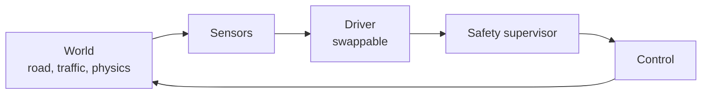

# AI-Self-Driving-Car

**A browser driving simulation made testable and measurable, one verified step at a time.**

[](https://github.com/apoorvrajdev/AI-Self-Driving-Car/actions/workflows/ci.yml)
[](LICENSE)


A 2D top-down simulation in which cars driven by small neural networks learn to drive by evolutionary search. It
starts from an educational JavaScript project and is being rebuilt, step by step, into a modular and tested
simulation. It is a simulation only: it never controls a real vehicle.

**Why.** The original runs on unseeded randomness and physics tied to the frame rate, so a run cannot be
reproduced or compared. This project adds tests and determinism before it adds features.

## At a glance

| | |
| --- | --- |
| **Today** | The original simulation, kept byte-identical to upstream in `baseline/` (11 files), and the same code as formatted, linted ES modules in `src/` that reproduce the same recorded runs, served by Vite, with 202 passing tests |
| **Planned** | Seeded, fixed-step, headless simulation; a road graph and traffic; swappable drivers; a safety supervisor; scenario metrics |
| **Toolchain** | Node.js 20+, Vite, Vitest, ESLint, Prettier, all exact-pinned dev dependencies; the simulation itself uses no libraries |
| **Delivery** | Pull requests only, merged with a merge commit; `lint and test` is a required check on `main` |
| **Results** | Four reference runs of the original (1,000 ticks each) are recorded in [docs/baseline-metrics.md](docs/baseline-metrics.md) |

## Status

Phase 0 (foundation) was signed off on 2026-11-09. Phase 1 (understand and measure the baseline) is in progress.
`baseline/` holds the original simulation, frozen and never edited. `src/` is the same code converted to ES
modules with its behaviour unchanged (the golden replay passes against both); Phase 2 restructures it further. Tasks, acceptance criteria and the log are in
[docs/TASKS.md](docs/TASKS.md).

| Phase | Scope | State |
| --- | --- | --- |
| 0 | Dev server, lint, characterization tests, commit-guard tests, CI, README and setup guide (T-000 to T-006) | Done |
| 1 | A written walkthrough of the baseline (T-101), a headless run of the unmodified code (T-102), recorded reference runs (T-103) | T-101 to T-103 done |
| 2 | ES modules, simulation and rendering split, fixed time step, seeded RNG, golden-trajectory tests | Planned |
| 3 | Road graph, vehicle model, traffic lights, traffic and pedestrians, scenario files | Planned |
| 4 | Parallel headless evolution, imitation learning, ONNX in the browser | Planned |
| 5 | Synthetic camera, detector, tracking, prediction, planner, safety supervisor, control | Planned |
| 6 to 7 | Scenario suite and driver comparison; profiling, live demo and write-up | Planned |

## Quick start

You need Node.js 20 or newer and npm. Prerequisites and details are in [docs/setup.md](docs/setup.md).

```sh
npm ci
npm run dev
```

Open <http://localhost:5173> (the address Vite prints). Other commands:

| Command | What it does |
| --- | --- |
| `npm run dev` | Serves the simulation from `src/` with Vite |
| `npm run dev:baseline` | Serves the frozen original from `baseline/` with Vite |
| `npm test` | Runs the test suite once (Vitest) |
| `npm run lint` | Lints the project (ESLint) |
| `npm run check` | Lint, then tests: the same steps CI runs |
| `npm run format` | Formats the tooling files and `tests/` with Prettier |

## Target architecture (planned, not built)

None of these layers exists yet. Today the whole simulation is the original frame loop in `src/main.js`. This is
the design the phases above build towards; interfaces and layer details are in
[docs/ARCHITECTURE.md](docs/ARCHITECTURE.md).



## Engineering practices you can verify

| Practice | Evidence |
| --- | --- |
| The original code is kept byte-identical | SHA-256 table recorded at T-001 in [docs/TASKS.md](docs/TASKS.md) and checked on `baseline/` by [baseline-hashes](tests/baseline-hashes.test.js); `baseline/**` is marked `-text` in [.gitattributes](.gitattributes) |
| Behaviour is pinned before any change | 66 characterization test runs: [utils](tests/utils.test.js) (30) and [network](tests/network.test.js) (36), each case run against the unmodified code in `baseline/` and against the `src/` modules; 19 tests of a [headless harness](tests/headless.test.js) and 2 of the [baseline hashes](tests/baseline-hashes.test.js) on `baseline/`. Quirks are recorded, not fixed |
| Reference runs of the original are recorded | Four golden runs in [tests/golden/](tests/golden), replayed against `baseline/` and against the `src/` modules and compared number by number: [golden](tests/golden.test.js) (18 tests), [golden-compare](tests/golden-compare.test.js) (19), [baseline-metrics](tests/baseline-metrics.test.js) (5), [mulberry32](tests/mulberry32.test.js) (7), and 14 tests of the [module bridge](tests/moduleSim.test.js). Numbers: [docs/baseline-metrics.md](docs/baseline-metrics.md) |
| The commit guards are tested | 52 tests in [tests/hooks.test.js](tests/hooks.test.js); the guards live in [.githooks/](.githooks) |
| Test tasks need a mutation check | Mutations of the code and the hooks were applied in scratch copies; results are in the T-003 and T-004 rows of the log |
| CI on every pull request and push to `main` | [ci.yml](.github/workflows/ci.yml): `npm ci`, lint, tests on Node 22 |
| Decisions are written down | 10 ADRs, 9 Accepted and 1 Proposed, in [docs/DECISIONS.md](docs/DECISIONS.md) |
| Determinism before features | ADR-0008 is Accepted. The test harness seeds `Math.random` so runs can be replayed; `src/` itself is still unseeded and per-frame, and the seeded RNG and fixed time step in the simulation are Phase 2 work |
| Pull requests, merge commits, one author | ADR-0009 and ADR-0006; the history check is recorded in the log |

## Limitations

- This is not yet an autonomous-driving system. The cars use five distance sensors and a `[5, 6, 4]`
  network (five sensor inputs); there is no perception, planning or safety layer.
- Learning is manual. There is no fitness function: you save the best car's brain and reload. The "best" car is
  the one furthest up the road, whether or not it has crashed.
- In `src/`, randomness is unseeded and physics advances per rendered frame, so a run of the page cannot be
  reproduced. Only the test harness replays runs, by seeding `Math.random` and calling the page's frame function
  (Phase 2 moves this into the simulation).
- Simulation and drawing are fused in `src/`; the harness runs them headless with stubbed canvases. One straight
  road, no lights or pedestrians.
- The only numbers published are the four reference runs of the original in
  [docs/baseline-metrics.md](docs/baseline-metrics.md). No benchmarks, frame rates or driving-quality metrics exist.
- The commit hooks are opt-in, need Node.js, and have only been used on Windows ([docs/setup.md](docs/setup.md)).
- `npm install` reports moderate audit findings in dev-only ESLint packages; `npm audit --omit=dev` reports none.

## Project layout

```text
baseline/               the 11 original files, frozen byte for byte (never edited)
src/                    simulation code as ES modules (the original behaviour, restructured further in Phase 2)
tests/                  characterization, headless-harness, golden-trajectory and commit-guard tests; helpers for loading and running the legacy scripts and the src/ modules; golden fixtures in tests/golden/
docs/                   architecture, decisions, tasks, setup
.githooks/              commit guards (see docs/setup.md)
.github/workflows/      continuous integration
.editorconfig  .gitattributes  .gitignore  .prettierrc  .prettierignore   repository settings
eslint.config.js        lint rules
vite.config.js          dev server and test settings
package.json            scripts and pinned dev dependencies (with package-lock.json)
LICENSE  NOTICE.md      licence and third-party credits
```

## Documentation

- [docs/ARCHITECTURE.md](docs/ARCHITECTURE.md): the original design, the target design and the conventions.
- [docs/baseline-walkthrough.md](docs/baseline-walkthrough.md): a plain-language tour of the original code and its frame loop.
- [docs/DECISIONS.md](docs/DECISIONS.md): why things are the way they are.
- [docs/TASKS.md](docs/TASKS.md): the task board, acceptance criteria and log.
- [docs/setup.md](docs/setup.md): prerequisites, commands and enabling the hooks.

## Credits and licence

The simulation in `src/` is the "Self-driving car, no libraries" course code by Radu Mariescu-Istodor
([gniziemazity/self-driving-car](https://github.com/gniziemazity/self-driving-car), folder `9. Fine-tuning`,
commit `8b87236`), used under the MIT licence. Full details are in [NOTICE.md](NOTICE.md). This project is
released under the same MIT licence; see [LICENSE](LICENSE).
