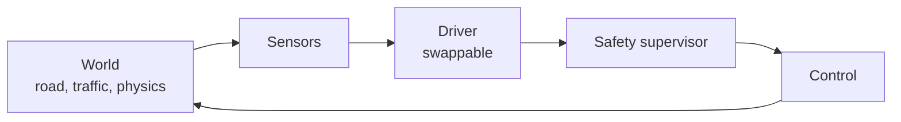

# AI-Self-Driving-Car

**A browser driving simulation made testable and measurable, one verified step at a time.**

[](https://github.com/apoorvrajdev/AI-Self-Driving-Car/actions/workflows/ci.yml)
[](LICENSE)


A 2D top-down simulation in which cars driven by small neural networks learn to drive by evolutionary search. It
starts from an educational JavaScript project and is being rebuilt, step by step, into a modular and tested
simulation. It is a simulation only: it never controls a real vehicle.

**Why.** The original runs on unseeded randomness and physics tied to the frame rate, so a run cannot be
reproduced or compared. This project adds tests and determinism before it adds features.

## At a glance

| | |
| --- | --- |
| **Today** | The original simulation in `src/` (11 files, byte-identical to upstream), served by Vite, with 84 passing tests |
| **Planned** | Seeded, fixed-step, headless simulation; a road graph and traffic; swappable drivers; a safety supervisor; scenario metrics |
| **Toolchain** | Node.js 20+, Vite, Vitest, ESLint, Prettier, all exact-pinned dev dependencies; the simulation itself uses no libraries |
| **Delivery** | Pull requests only, merged with a merge commit; `lint and test` is a required check on `main` |
| **Results** | None recorded yet. Reference runs of the original are planned for Phase 1 (T-103) |

## Status

Phase 0 (foundation) was signed off on 2026-11-09. Phase 1 (understand and measure the baseline) is in progress.
`src/` holds the original simulation, unchanged, and nothing in it has been refactored yet. Tasks, acceptance
criteria and the log are in [docs/TASKS.md](docs/TASKS.md).

| Phase | Scope | State |
| --- | --- | --- |
| 0 | Dev server, lint, characterization tests, commit-guard tests, CI, README and setup guide (T-000 to T-006) | Done |
| 1 | A written walkthrough of the baseline (T-101), a headless run of the unmodified code (T-102), recorded reference runs (T-103) | T-101 written, awaiting my review; T-102 and T-103 planned |
| 2 | ES modules, simulation and rendering split, fixed time step, seeded RNG, golden-trajectory tests | Planned |
| 3 | Road graph, vehicle model, traffic lights, traffic and pedestrians, scenario files | Planned |
| 4 | Parallel headless evolution, imitation learning, ONNX in the browser | Planned |
| 5 | Synthetic camera, detector, tracking, prediction, planner, safety supervisor, control | Planned |
| 6 to 7 | Scenario suite and driver comparison; profiling, live demo and write-up | Planned |

## Quick start

You need Node.js 20 or newer and npm. Prerequisites and details are in [docs/setup.md](docs/setup.md).

```sh
npm ci
npm run dev
```

Open <http://localhost:5173> (the address Vite prints). Other commands:

| Command | What it does |
| --- | --- |
| `npm run dev` | Serves the simulation from `src/` with Vite |
| `npm test` | Runs the test suite once (Vitest) |
| `npm run lint` | Lints the project (ESLint) |
| `npm run check` | Lint, then tests: the same steps CI runs |
| `npm run format` | Formats the tooling files and `tests/` with Prettier |

## Target architecture (planned, not built)

None of these layers exists yet. Today the whole simulation is the original frame loop in `src/main.js`. This is
the design the phases above build towards; interfaces and layer details are in
[docs/ARCHITECTURE.md](docs/ARCHITECTURE.md).



## Engineering practices you can verify

| Practice | Evidence |
| --- | --- |
| The original code is kept byte-identical | SHA-256 table in [docs/TASKS.md](docs/TASKS.md); `src/**` is marked `-text` in [.gitattributes](.gitattributes) |
| Behaviour is pinned before any change | 32 characterization tests: [utils](tests/utils.test.js) (14) and [network](tests/network.test.js) (18). Quirks are recorded, not fixed |
| The commit guards are tested | 52 tests in [tests/hooks.test.js](tests/hooks.test.js); the guards live in [.githooks/](.githooks) |
| Test tasks need a mutation check | Mutations of the code and the hooks were applied in scratch copies; results are in the T-003 and T-004 rows of the log |
| CI on every pull request and push to `main` | [ci.yml](.github/workflows/ci.yml): `npm ci`, lint, tests on Node 22 |
| Decisions are written down | 10 ADRs, 9 Accepted and 1 Proposed, in [docs/DECISIONS.md](docs/DECISIONS.md) |
| Determinism before features | ADR-0008 is Accepted. Seeded randomness and a fixed time step are Phase 2 work, not done yet |
| Pull requests, merge commits, one author | ADR-0009 and ADR-0006; the history check is recorded in the log |

## Project layout

```text
src/                    simulation code (the original files, unchanged for now)
tests/                  characterization tests and commit-guard tests
docs/                   architecture, decisions, tasks, setup
.githooks/              commit guards (see docs/setup.md)
.github/workflows/      continuous integration
eslint.config.js        lint rules
vite.config.js          dev server and test settings
package.json            scripts and pinned dev dependencies
LICENSE  NOTICE.md      licence and third-party credits
```

## Documentation

- [docs/ARCHITECTURE.md](docs/ARCHITECTURE.md): the original design, the target design and the conventions.
- [docs/DECISIONS.md](docs/DECISIONS.md): why things are the way they are.
- [docs/TASKS.md](docs/TASKS.md): the task board, acceptance criteria and log.
- [docs/setup.md](docs/setup.md): prerequisites, commands and enabling the hooks.

## Credits and licence

The simulation in `src/` is the "Self-driving car, no libraries" course code by Radu Mariescu-Istodor
([gniziemazity/self-driving-car](https://github.com/gniziemazity/self-driving-car), folder `9. Fine-tuning`),
used under the MIT licence. Full details are in [NOTICE.md](NOTICE.md). This project is released under the same
MIT licence; see [LICENSE](LICENSE).
