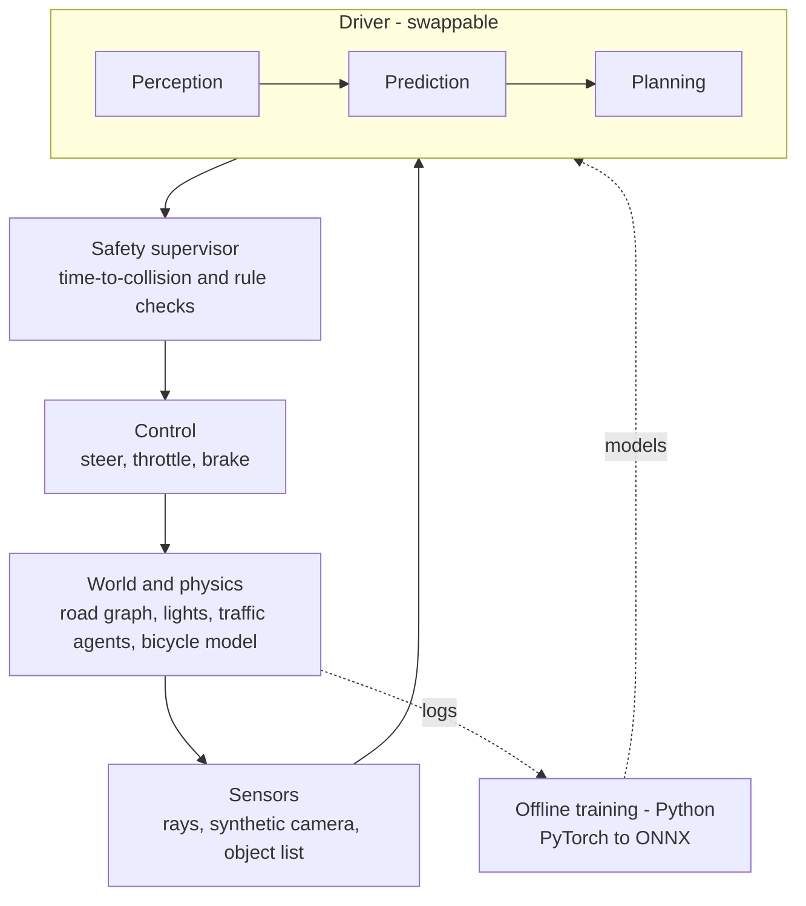

# Architecture

**Status:** Phase 1 — understand and measure the baseline. `src/` still holds the original code unchanged (task T-001).
This document describes the original design, the target design, and the conventions every change follows.
Decisions behind it are recorded in [DECISIONS.md](DECISIONS.md); work in progress is in [TASKS.md](TASKS.md).

## 1. Overview

The project starts from the "Self-driving car — no libraries" course code by Radu Mariescu-Istodor
(MIT, [gniziemazity/self-driving-car](https://github.com/gniziemazity/self-driving-car)): a 2D top-down browser
simulation in which cars driven by small neural networks learn to drive by evolutionary search.
It is being extended, step by step, into a modular autonomous-driving stack — world, sensors, perception,
prediction, planning, safety and control — with swappable drivers that are scored on the same reproducible
scenarios.

## 2. Baseline (original design)

Source: folder `9. Fine-tuning` of the original repository, about 730 lines of dependency-free JavaScript.
Classic `<script>` files share global classes; everything runs inside one `requestAnimationFrame` loop.
A line-by-line tour is in [baseline-walkthrough.md](baseline-walkthrough.md).

| File | Responsibility | Notes |
| --- | --- | --- |
| `main.js` | Creates the road, 100 AI cars and 7 traffic cars; runs the frame loop; picks the best car; save/discard | Best car = smallest `y` (furthest up the road) among all cars, damaged ones included. Brain stored in `localStorage` |
| `car.js` | Car state, movement, collision polygon, damage, drawing | Arcade physics per frame: accel 0.2, friction 0.05, max speed 3 (traffic 2), turn 0.03 rad. A damaged car stops moving, but its sensor and network keep running |
| `controls.js` | Four booleans: forward, left, right, reverse | Handles `KEYS` (never used by `main.js`) and `DUMMY` (always forward); AI cars get their flags from the network in `car.js` |
| `road.js` | Straight road, 3 lanes, two border segments | `getLaneCenter(i)`; borders span ±1,000,000 px |
| `sensor.js` | 5 rays, 150 px long, spread over 90° | Reading per ray = nearest hit; network input = `1 − offset`, or 0 when nothing is hit |
| `utils.js` | `lerp`, segment intersection, polygon intersection, colours | Brute-force collision over all edges |
| `network.js` | Feed-forward network `[5, 6, 4]` and `mutate()` | Step activation: output 1 when weighted sum > bias, else 0 |
| `visualizer.js` | Draws the best car's network with live activations | Teaching aid; kept |

**Per-frame loop (`main.js → animate`)**

1. Update traffic cars (road borders passed, empty traffic list: no traffic–traffic interaction).
2. Update every AI car. While undamaged: move → rebuild polygon → collision check. Always: cast rays → network forward → set controls.
3. Select the best car, translate the camera to it, draw road, traffic and cars, draw the network.

**Learning** is manual: the owner saves the best brain; on reload car 0 keeps it and the other 99 are copies
moved 10% towards random values (`mutate(brain, 0.1)`). There is no fitness function: the best car is the one with
the smallest `y`, damaged or not, and `save()` stores its brain.

**Known limitations**

- Physics advances per rendered frame, not per unit of time; speeds are in pixels per frame.
- `Math.random` is unseeded, so runs cannot be reproduced.
- Simulation and rendering are fused; nothing can run headless or faster than real time.
- Global classes, no modules. `utils.js` and `network.js` have characterization tests, and the whole baseline runs
  headless through `tests/helpers/headless.js` (T-102); the other files are covered only through that harness.
- One straight road; traffic drives straight at constant speed; no lights, junctions or pedestrians.
- Saved brains break when the network shape changes.

## 3. Target architecture



| Layer | Responsibility | Introduced |
| --- | --- | --- |
| World and physics | Deterministic state: roads, lanes, lights, agents; fixed time step; seeded RNG | Phase 2–3 |
| Sensors | Turn world state into observations, with optional noise | Phase 2–5 |
| Driver | Observation → command. Implementations: evolved network (original), imitation policy (ONNX), modular stack | Phase 4–5 |
| Perception | Detection, traffic-light state, lane estimate, tracking | Phase 5 |
| Prediction | Short-horizon motion of other agents | Phase 5 |
| Planning | Route (A*) → behaviour state machine → trajectory | Phase 5 |
| Safety supervisor | Independent checks that may override any driver | Phase 5 |
| Control | Path tracking (pure pursuit + PID) to steer/throttle/brake | Phase 5 |
| Render | Canvas drawing and debug overlays; absent in headless runs | Phase 2 |
| Tooling | Headless runner, scenario suite, metrics, CI | Phase 2–6 |

## 4. Core interfaces (target, Phase 2 onwards)

```js
// World advances deterministically from a seed.
world.step(dtSeconds)                       // → void
// A sensor observes the world from one car.
sensor.read(world, car)                     // → Observation
// Every driver implements the same contract.
driver.act(observation)                     // → { steer, throttle, brake }
// The safety supervisor may replace a command.
safety.check(command, world, car)           // → Command
// Rendering is optional and never changes state.
renderer.draw(world, { debug })             // → void
```

Interface changes require an ADR.

## 5. Repository layout

| Path | Contents | Committed |
| --- | --- | --- |
| `src/` | Simulation code (baseline files until Phase 2) | yes |
| `tests/` | Unit, characterization and scenario tests | yes |
| `docs/` | Architecture, decisions, tasks, setup | yes |
| `.githooks/` | Commit guards (identity, message, blocked files) | yes |
| `.github/workflows/` | CI | yes |
| `scenarios/` | Seeded scenario definitions (Phase 3+) | yes |
| `training/` | Offline Python training code (Phase 4+) | yes, without data or runs |
| `reference/` | Read-only clones of the original repositories | no |

Target `src/` layout from Phase 2: `sim/`, `sensors/`, `perception/`, `prediction/`, `planning/`, `safety/`,
`control/`, `drivers/`, `render/`. Final names are decided in Phase 2.

## 6. Conventions

- **Coordinates (baseline):** canvas pixels, `y` grows downwards, cars drive towards negative `y`.
  `angle = 0` points up; positive `angle` turns left; motion is `x -= sin(angle)·speed`, `y -= cos(angle)·speed`.
- **Units:** baseline speeds are pixels per frame; from Phase 2, per fixed tick, with units in variable names.
- **Determinism:** from Phase 2, all randomness goes through one seeded RNG passed in explicitly.
- **Testing:** characterization tests pin current behaviour before any refactor; golden trajectories guard the
  Phase 2 restructure; seeded scenarios measure drivers from Phase 3 on.
- **Performance budget:** 60 frames per second in the browser for the default scenario; headless runs as fast
  as the CPU allows.
- **Safety:** simulation only. The safety supervisor is evaluated with its own metrics (violations, minimum
  time-to-collision).
